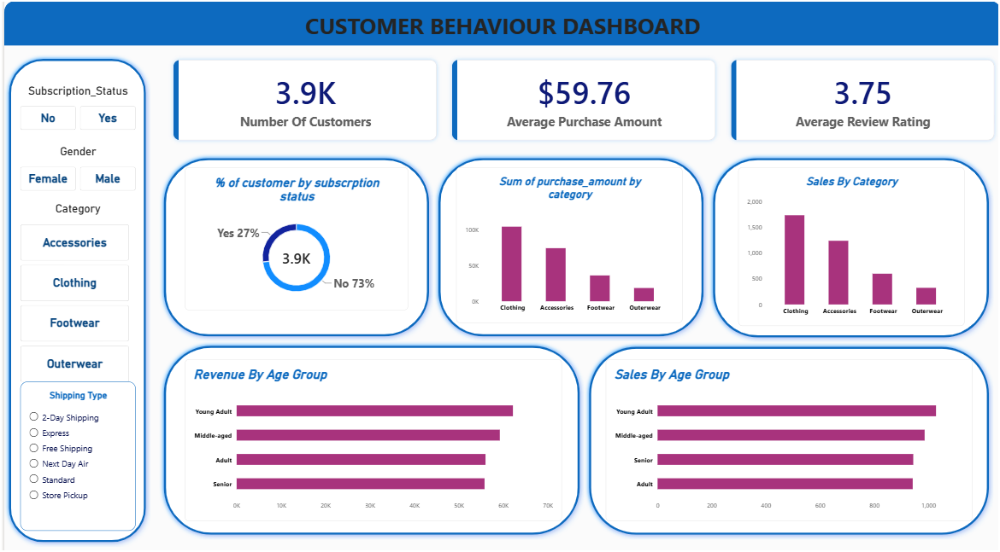

<div align="center">

# 🛍️ Customer Behaviour Data Analytics

### Turning Customer Shopping Data into Business Insights


</div>

---

## 📌 Project Overview

This project focuses on analyzing customer shopping behaviour using **SQL and Power BI** to identify purchasing patterns, customer preferences, sales trends, and business insights.

The objective is to transform raw customer data into meaningful insights that help businesses understand their customers and make data-driven decisions.

---

## 🎯 Project Objectives

- Analyze customer purchasing patterns.
- Identify popular product categories.
- Understand customer demographics and preferences.
- Evaluate the impact of discounts on purchases.
- Analyze customer spending behaviour.
- Build an interactive Power BI dashboard.

---

## 🛠️ Tools & Technologies

| Tool | Purpose |
|---|---|
| SQL | Data cleaning and analysis |
| PostgreSQL | Database management |
| Power BI | Interactive visualization |
| Excel | Dataset exploration |

---

## 📊 Key Analysis

- Customer segmentation and purchasing behaviour.
- Product category performance.
- Discount and promotional analysis.
- Purchase frequency analysis.
- Customer demographics analysis.
- Sales and revenue insights.

---

## 📈 Dashboard Preview

<div align="center">

### Interactive Power BI Dashboard

<!-- Add your dashboard screenshot here -->



</div>

---

## 📂 Project Structure

```text
Customer-Behaviour-Data-Analytics/
│
├── Dataset/
│   └── customer_shopping_behavior.csv
│
├── SQL/
│   └── customer_analysis.sql
│
├── Dashboard/
│   └── customer_behavior_dashboard.pbix
│
└── README.md
